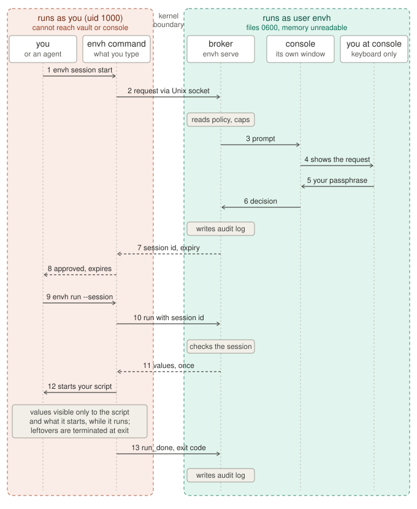

# Security model

What envh protects, how, and where it stops. The README has [the short version](../README.md#what-it-covers-and-what-it-doesnt); this is the full one.

- [Status](#status-and-an-honest-disclaimer)
- [How a request flows, and where the boundaries are](#how-a-request-flows-and-where-the-boundaries-are)
- [What it protects, and what it does not](#what-it-protects-and-what-it-does-not)
- [Habits that keep this safe](#habits-that-keep-this-safe)
- [Who else can see and type into the console](#who-else-can-see-and-type-into-the-console)
- [What envh does not do](#what-envh-does-not-do)
- [Roadmap](#roadmap)

## Status, and an honest disclaimer

This project was largely AI-written ("vibe-coded"), then tested locally and red-teamed with AI; the caveats that surfaced are documented below in [What envh does not do](#what-envh-does-not-do). It is **defense in depth, not a guarantee** — someone determined, with enough same-user access, can still get past it.

It is still a real improvement over the usual alternative, a plaintext `.env` sitting in your project folder. Against that baseline, envh keeps keys out of files anything running as you can read at will; it **significantly** lowers the chance of prompt-injection exfiltration (a key is released only to a run or session you approved, unless you marked it `auto`, and every use is logged); it lowers the chance of a supply-chain dependency silently taking **every** key even more; and if something does slip through, it shrinks the blast radius to the few keys in one approved run or session rather than everything on disk.

Think of it as a locked door on what was an open entryway: stronger protection exists (a hardware token, phone approval, running agents in a VM), but a locked door beats leaving your secrets out in the open.

## How a request flows, and where the boundaries are

What each step means for you:

- **Steps 1 and 9 are commands you (or an agent) type in an ordinary terminal.** The `envh` command is just a client; it holds no secrets and has no special rights.
- **Steps 3 to 6 happen in a different window**: the console that `sudo envh-console` opened. It is where every approval happens, and it is the only place.
- **Steps 8 and 12 are what the client does on your side.** It prints the session id; it never prints a value. Values go straight into the environment of the script you named, and nowhere else: not into your shell, not into a file.
- **After step 13 the values are gone.** They lived only in the environment of the script and of processes it started. When the script exits, `envh run` terminates any of those processes still running (it tags the run and finds them by that tag), so nothing that received the values survives the run; the audit log records how many were stopped. Pass `--keep-background` if a run is meant to leave a daemon behind, and treat that daemon as holding the values. What envh cannot undo is a copy the script itself made, for example into a log file.

The boundaries, in words:

| Boundary | What enforces it | What it means |
|---|---|---|
| **Red box vs green box** | Linux user separation. The vault, policy files and audit log are owned by `envh` with mode 0600; the broker is a different user, non-dumpable, with no secrets in its environment. | You, your scripts, and any agent running as you cannot read a secret, a policy or the log, and cannot change what is allowed. |
| **The socket** | A Unix socket in `/run/envh`, a directory only `envh` can write. The broker reads the connecting process's uid from the kernel (`SO_PEERCRED`, not spoofable) and only talks to logins listed under `users:` in `config.yaml`. | Anyone running as a listed user can *ask*. Asking never grants anything; it only puts a prompt on the console. Other local accounts are refused before they can see or request anything. |
| **Per-user sessions** | Every session and pending request is tagged with the kernel-reported uid that created it. | A session can be used, waited on, listed or ended only by the user who opened it. Two listed users on one machine cannot use each other's sessions; only the console sees everything. |
| **The console keyboard** | `TIOCSTI` disabled in the kernel, the terminal you type into chowned to `envh`, approval by your vault passphrase typed hidden, next to your console phrase. | No process running as you can inject keystrokes through the terminal itself. Something that can type but cannot see your screen or record your keys cannot approve without the passphrase. A fake prompt elsewhere cannot show your console phrase. Your display and input devices are a separate way in; see the next row. |
| **Not a boundary** | | During step 12 the value is in a process running as you, like any environment variable. A session id is a bearer token for its lifetime; `envh list` leaves it out, but anything running as you may find it in a command line, an environment or a transcript. The reason and the pid shown in the prompt are claims by the requester. On an X11 desktop, a same-user process can record the passphrase as you type it and then type it into the console itself; see [Who else can see and type into the console](#who-else-can-see-and-type-into-the-console). |

## What it protects, and what it does not

**Kernel-enforced, against any process running as you (including every agent):**

- The vault, the policy files and the audit log are owned by the service user `envh` with mode 0600. You cannot read them; neither can an agent.
- The vault is encrypted at rest (age, passphrase mode) for the case of a stolen or copied disk.
- The broker's memory is unreadable: a different user, marked non-dumpable, with no secrets in its environment.
- Nothing can type into the console through its terminal. Linux 6.2+ disables the `TIOCSTI` ioctl (checked at start), and the terminal you type into is chowned to `envh` before the broker starts. Your display server and input devices are another way in; see [Who else can see and type into the console](#who-else-can-see-and-type-into-the-console).
- The code is root-owned under `/opt/envh`; the only client is `/usr/local/bin/envh`.

**What a key use means:** the approved command receives the real value in its environment. It is visible to that process, to everything it imports, and to every other process running as you while it runs. A malicious dependency no longer gets every key on disk whenever it likes; it gets the values of the one approved run it is part of, and you see that run in the log.

**While you are not at the console, nothing is approved or changed.** Approving a request always asks for your vault passphrase, typed hidden, and so does changing the passphrase. Other changes on the console (to keys, presets or settings) ask for it once, then only for a confirmation for the next hour; `/lock` ends that hour early. A wrong passphrase is logged and pauses the console for two seconds, so guessing by typing blind is slow and visible. With the console closed, the vault is encrypted with that passphrase, which is stored nowhere. The exceptions are a session you already approved, which keeps working until it expires, and keys you marked `auto`, which any run gets while the console is running.

**One passphrase, on purpose.** The vault passphrase both unlocks the vault and approves requests, so approving is one thing to type. That costs some security, and you should know what: you type the passphrase often, so on X11 a program running as you has many chances to record it; and anyone who learns it can approve at your console and also decrypt any copy of `vault.age`, such as a backup. To make a fake prompt easy to spot, every approval prompt shows your console phrase: type the passphrase only where you see it. See [Who else can see and type into the console](#who-else-can-see-and-type-into-the-console).

See [What envh does not do](#what-envh-does-not-do) before relying on it.

## Habits that keep this safe

- **Never type `sudo` in a terminal an agent can reach**, such as the terminal pane of the Claude desktop app. sudo caches your credential for that terminal for several minutes, and the agent could run `sudo -n <anything>` there. Run privileged commands in a separate window, and consider `sudo -k` right after (the wizard does this for you).
- Start the console in its own window. Never inside an agent's terminal pane.
- Keep `NOPASSWD` out of sudoers (and `nopass` out of `doas.conf`), and stay out of the `docker` group and the others that grant root. The install checks these; rerun the wizard after you change groups or sudo settings.
- Read the whole prompt before typing the passphrase: the reason, the variables, the duration, the command line.
- Type the vault passphrase only where your console phrase is shown. If you typed it on an X11 desktop while something untrusted was running, change it with `/passphrase` from a text console.
- Do not paste secrets into chats, commits, logs or command lines.
- Treat `/var/lib/envh` as secret material if you ever copy or back it up. Back up `vault.age` only to encrypted media; recovering it needs only the standard `age` tool: `age -d vault.age`.
- Approve only where nothing running as you can see or type. On X11, or with `/dev/uinput` writable by you, a desktop terminal window does not qualify; see the next section.

## Who else can see and type into the console

The console is only as safe as the screen you read it on and the keyboard you type into it. On an ordinary desktop, three things let a program running as you reach both. An agent that gets past the Claude Code or Cursor hook, or never meets it, can use them.

- **An X11 session** (`echo $XDG_SESSION_TYPE` prints `x11`). Every program running as you can read any window, record every key you type, and type into any window. It can record the vault passphrase, and your sudo password, as you enter them, and then type the passphrase into the console itself. With your sudo password it has root, and root beats envh.
- **Write access to `/dev/uinput`.** It lets a program create a virtual keyboard that types into whatever has focus: X11, Wayland and text consoles alike. Some udev rules give it to the logged-in user, for example Steam's `60-steam-input.rules`; `getfacl /dev/uinput` then shows a `user:<you>` line. To remove it, override the rule with a file of the same name in `/etc/udev/rules.d` without the uinput line, then reboot. Typing blind, it does not know the passphrase; the pause after each wrong attempt keeps it from guessing.
- **Running the console inside tmux or screen started as you.** Anything running as you can send keys to it. The console warns, before you type the passphrase and again on its home screen, when it runs inside tmux, screen, zellij, dtach or abduco that root did not start.
- **Membership in the `input` group.** It lets a program read every key you type on any screen, the vault passphrase and your sudo password included. The install warns about it and about a writable `/dev/uinput`.

What does not fix it:

- **The passphrase, on X11.** It stops anything that can type but cannot see or record, such as a virtual keyboard on Wayland or a text console. On X11, a program running as you can record it the first time you type it, and approve on its own after that. If that may have happened, change it with `/passphrase` from a text console.
- **One-time codes** (backup codes, an authenticator app). A recorded code cannot be replayed. But a program that can draw over and type into your windows can show you a fake request, or change the request as you type, so your code approves its request.
- **The Claude Code or Cursor hook.** It sees only the command text, so a few lines of Python that talk to the display get past it, and so does a script file. It also covers only the agent's shell commands, not MCP servers, other agents, or a package inside a script you run.

What does:

- **Approving where nothing running as you can see or type.** That can be a text console: press Ctrl-Alt-F3, log in, run `exec sudo envh-console`, after making sure `/dev/uinput` is not writable by you. Your desktop's lock screen does not cover text consoles. It can also be another device over SSH: key-only, not reachable from the internet, and not inside a tmux or screen you own. Closing that connection closes the console and ends all sessions.
- **A Wayland session.** It stops programs reading and recording across windows, which protects your sudo password everywhere, but it does nothing about `/dev/uinput`.
- **An OS sandbox around agent commands** (Claude Code's Bash sandbox, a dev container). It protects against agents only, and only if it actually blocks the display and `/dev/uinput`: inside it, `xset q` and `test -w /dev/uinput` should both fail.

## What envh does not do

- **For an hour after you type the passphrase for a change, changes are unlocked.** Anything that can type into the console window during that hour (see [Who else can see and type into the console](#who-else-can-see-and-type-into-the-console)) can rename, replace, show or remove keys and change presets and settings without knowing the passphrase. It still cannot approve a request or change the passphrase. `/lock` ends the hour early, and stopping the console ends it too.
- **Showing a value puts the whole key where others can get it.** It is on screen for up to 30 seconds, and it passes through your terminal, so a terminal session recording would hold it. Selecting it with the mouse puts it on your selection or clipboard, where every program running as you, agents included, can read it. The audit log records which key was shown, not its value.
- **A key marked `auto` is not protected by approval.** While the console runs, any process running as a listed user, agents included, gets it by asking. Use `auto` only for keys whose leak costs little.
- **The console shows the ends of each key.** `/keys` shows the first and last few characters of every value (at most a fifth of it, and nothing of a value under 12 characters), so a key can be matched with a provider's dashboard. Anyone who can see the console's screen sees those characters too; the rest stays hidden.
- **Approving a scan's search shares the ends of each key.** The scan, running as you, gets the first and last few characters and the length of every stored key of 20 characters or more, as the console shows them, and one answer to which found values are stored keys. Any program could send the same request, so approve only a scan you ran.
- **It does not hide a value from the command that receives it.** Values are visible to that process, everything it imports, and every other process running as you for the duration of the run. envh cannot revoke a value once delivered, cannot undo a copy the command made (a log line, a file, a cache), and a session expiring does not stop a running command. It does end the run cleanly: processes the command left behind are terminated when it exits.
- **It does not isolate an agent from your other repositories, your home directory, or the network.** That needs a container or VM around the agent; see the [Roadmap](#roadmap). On the host, your agent's own permission rules and classifier are the only control over what else it reads.
- **A session id is a bearer capability within your own account.** Anything running as you that obtains it can use it until it expires. `envh list` and `envh status` leave ids out, and `envh session wait` needs the resume code only the asking program was shown, so agents working side by side don't pick up each other's sessions. That is a courtesy, not a boundary: a process running as you can still find an id in another process's command line or environment, or in an agent's transcript. What protects you is what you approve, so keep sessions short and specific. Other local accounts cannot use a session: the broker checks the kernel-reported uid of every connection against the session's owner.
- **A session id is two words, so it is easy to guess.** It is short so that you can read it out and type it from memory. The uid check refuses another account whatever it guesses, and another user's session reads as unknown, so guessing does not even reveal which ids are live. For a process running as you, the broker logs every unknown id on the console and, after 20 from one user, refuses all of that user's sessions until the console restarts. With about 36,000 ids, 20 guesses at three live sessions find one about 1 time in 600.
- **envh's boundary is the kernel user separation, not a check on what you run.** The vault and broker live under a separate Linux user you cannot read, and the broker trusts only the kernel-reported uid of whoever connects. Within that boundary, envh receives a command and returns the keys' values to the client process; it cannot tell a legitimate use from a bait-and-switch. A malicious program can show you one command and `--reason` on the console, collect the keys, then feed them to a different script — and envh will not catch it (the audit log, too, records the command the client reported, not a verified account of what ran). **Confirming that the command you approve is the real use of the keys is your job, not envh's.** The Claude Code / Cursor hooks help, by flagging in your agent's UI that a command is about to ask envh for keys — a heads-up and a chance to deny; but they run in your userspace as you, so an agent that has already altered that userspace (the hook itself, the `envh` client, your `PATH`, or the target script) can defeat the heads-up or change what runs.
- **You approve a command line, not the code it runs.** A run prompt shows `python deploy.py` — not what `deploy.py` contains, what `python` resolves to on your `PATH`, or what it imports. The code is read at run time, as you, so it can differ from what you reviewed: changed by another process after you approve, resolved to a different binary via `PATH`, or never inspected in the first place. Within a session, later runs whose keys are already granted need not reach the console at all. The same read-then-write gap applies to `envh import`, which rewrites each file in place. envh's guarantee is that the approved keys went to this user for this command line, not that a specific reviewed program ran unchanged — so review the code you run, and keep the machine in a known-good state.
- **The console is only as trusted as your display and terminal.** On X11, same-user processes can record the passphrase and type it into the console; see [Who else can see and type into the console](#who-else-can-see-and-type-into-the-console). The desktop launcher can be shadowed by a file in `~/.local/share/applications`; the console phrase makes an impostor recognizable, it does not prevent one.
- **It does not stop a persistent same-user attacker from phishing you later.** An agent that can edit your shell startup files or desktop configuration could capture the sudo password or vault passphrase at the next start. Claude Code's protected-path rules reduce this; only running agents in a container removes it.
- **It does not change your sudo settings.** sudo keeps remembering your password for several minutes in the terminal you typed it in, and anything running there can use it. Run the wizard and `sudo envh-console` in windows no agent can type into; the wizard runs `sudo -k` when it is done.
- **The vault is only as strong as the passphrase**, which also approves requests. Copies of `vault.age` or `audit.jsonl` outside `/var/lib/envh` must be treated as secrets. The audit log holds command lines and reasons, never values.
- **The import wizard leaves a plaintext backup until you delete it.** It copies each original file to `~/envh-backups-and-scans/import-backups/<date-time>/` (or a folder you choose) before rewriting it in place, and prints that path. Until you remove the folder, the old values are exactly as exposed as they were in the original files.
- **Requirements it will refuse without:** Linux 6.2+ with `legacy_tiocsti=0`, Yama ptrace scope 1 or more, sudo and doas with a password, sudo remembering a password per terminal and with a `secure_path`, your user outside root-granting groups (its primary group included) and unable to use a root container daemon's socket, and the folders root runs envh from writable only by root. These are checked when you install, for the account that installs; a sudo or doas rule added later is not checked until you run the wizard again. Groups are checked again for every listed user each time the console starts, and for a user added in `/settings` before you save; the console warns about them but does not refuse.
- **Not provided:** rotating or revoking keys at the provider, per-request network allow-lists, rate limits, remote use, macOS or Windows support, protection against root or physical access while the broker is running. Several local users can be listed in `users:` and each gets their own sessions, but they share one vault, one policy and one console.

## Roadmap

- **Phone approval, like a Duo push.** The broker sends each request's details to your phone and you approve there; only a reply signed by a key that never leaves the phone counts. The screen you read and the button you press are then off the computer, which closes the attacks in [Who else can see and type into the console](#who-else-can-see-and-type-into-the-console) without a text console.
- **An OS sandbox for agents.** Run each agent in a dev container or VM, or a checked configuration of Claude Code's Bash sandbox. The agent then cannot reach your display, `/dev/uinput`, your home directory, or more of the network than it needs, and envh's socket is its way to ask for keys. This also isolates agents from your other repositories, which envh does not do today.
